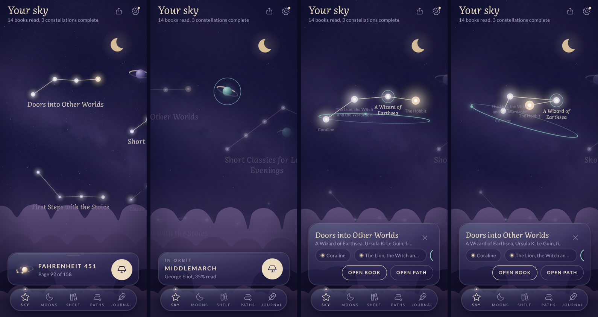
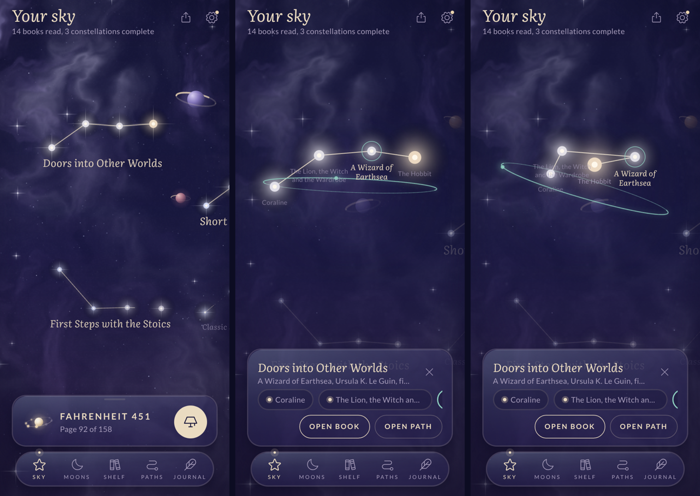

# Phase 25: a sky in 3D

The Sky should feel like a small planetarium you hold, not a flat picture.

## Deep space

The Sky's backdrop is deep space in the app's own indigo and plum: a nebula of folded gas (noise warped through itself) with lavender wisps and dark dust lanes, a dense field of tiny stars, and a few bright stars with four-pointed sparkles. Finished books' stars carry the same sparkle. The storybook moon and cloud banks are left off the Sky (`SKY_CLOUDS` in `src/features/sky/look.ts` brings them back); other screens keep their clouds. Everything is baked into still images once, so it costs nothing per frame.

## What the reader sees

- **Constellations brought close.** Tap a constellation (or one of its stars) and it leaves the chart and comes forward as a small solid. Its stars keep their places but gain real depth, so it tips back to show its volume and sways very slowly while it rests. Drag to turn it like an object in the hand; a flick keeps it turning a little and it settles back to its resting tilt. Pinch to bring it nearer.
- **Stars light up one by one.** As it opens, its finished books light in reading order. A book being read glows by how far along it is and carries a candlelit ring that fills page by page. Books not yet read are outlines waiting for their light. Each book's title sits under its star, nearer titles brighter.
- **Orbits.** A teal orbit circles the shape, lit along its length as far as the path has been read, with a bead where the reader is now. Its far half passes behind the stars and its near half in front, which is what makes it read as 3D. A fainter second orbit leans the other way for a sense of space. Threads between finished stars glow, and fade toward their far end.
- **Planets.** A book being read that no constellation holds yet is a small world in the open sky, lit from the upper left like the moon, with a thin atmosphere. Its leaning ring fills as the pages go by, and long books (350+ pages) carry a broad ring. Tap a planet to see the book and light the lamp. Once finished it becomes a star like the rest.
- **Turn the sky.** Two fingers turn the whole chart like a planetarium dome; names stay upright. Double tap comes home and turns back.
- **Glass.** The cards on the clouds and the tab bar are panes of night glass: translucent indigo, a cool sheen where they catch the moon, a fine bright rim. They float a few points against the sky as the phone tilts.
- **Floating tab bar.** The tab bar floats clear of the edges above the cloud bank. The active tab's small star rests on its top edge and glows.
- **The close-up card** names the constellation and how much of it is lit, lists its books as a row of small stars (tap one to pick it in the close-up), and offers Open book and Open path.

## Calm

One slow sway (32 s) while a close-up rests; nothing flashes. Under Reduce Motion the close-up opens instantly, fully lit, already tipped back, with no sway or fling, and the glass does not float. Turning by hand still works.

## How it is built

- `src/domain/orbit.ts`: projection with perspective, a constellation's solid, orbit points, the one-by-one lighting, close-up fit and hit testing. Pure and tested (`orbit.test.ts`).
- `src/components/sky/ConstellationCloseUp.tsx`: the close-up in one Skia canvas, driven by shared values (yaw, pitch, zoom, open, lit), so turning never waits for JavaScript. Orbits are rebuilt as paths on the UI thread each frame.
- `src/domain/starChart.ts`: planets in the layout and in hit testing. `StarChartView` draws them.
- `src/components/Glass.tsx`: the glass pane. No backdrop blur, so no new native module and the same look on every phone; true blur (expo-blur) could come later with a new dev build.
- The Sky screen's gestures switch on a shared `closeMode`: on the chart, drag wanders and two fingers turn; up close, drag turns the constellation.

## Not checked yet

Screenshots are from the web build. Tilt, the floating glass, two-finger turning and Reduce Motion need a real phone.
