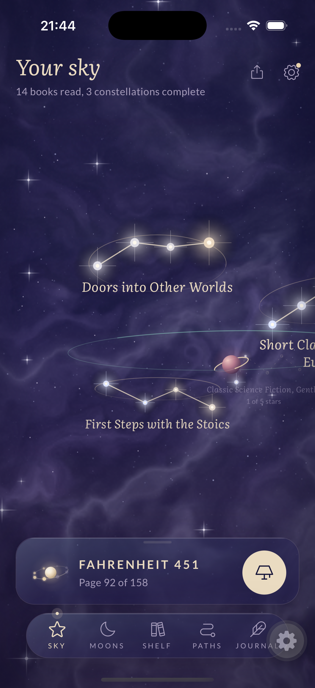
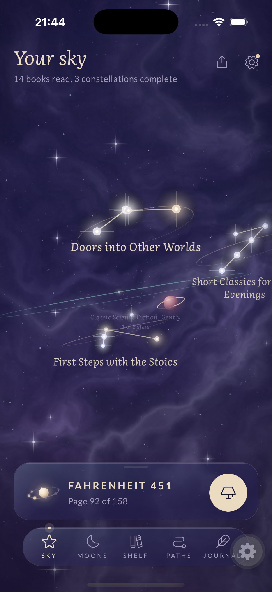

# Phase 26: the whole sky in 3D

**Status:** shipped

Phase 25 made a constellation 3D once it was brought close, but the resting
sky was still a flat chart: every shape drawn on one plane. Now the whole sky
is a small world in 3D, like an interactive planetarium.

 

## What the reader sees

- **A sky with real depth.** Every constellation hangs at its own distance
  (finished ones nearer, ones still being read farther back) and has its own
  volume. Lone stars and planets float between them, and a field of faint
  far stars fills the space.
- **Drag turns the sky.** The camera turns about the constellation it is
  looking at, so near shapes swing past far ones, constellations foreshorten
  as they turn, and the planet slides between them. A flick keeps it turning
  a little and it slows to rest. Pinch comes closer. Double tap goes home.
- **It swings in once.** On opening, the sky turns gently into place over two
  seconds, so it reads as a place, not a picture. That is the only motion
  nobody asked for.
- **Light.** Stars are points of light: a soft halo that adds up where halos
  overlap, their own colour (warmer for longer books), a hot core and four
  fine rays on finished books. Near stars are larger and brighter; far ones
  smaller and fainter. Threads between finished stars glow and fade toward
  their far end; threads to books not yet read are faint dotted guides.
- **Orbits.** A wide teal orbit rings the whole scene like the ecliptic on a
  planetarium dome, its far half faint and behind the stars, its near half
  brighter and in front. Each finished constellation carries its own small
  candlelit orbit, split the same way.
- **Names** follow their constellations through space, smaller when far, and
  fade as a shape turns edge on.
- **Tap a constellation** and the camera flies to it, then it comes the rest
  of the way as the Phase 25 close-up, and its books light star by star.
  Planets and lone stars open their cards as before. The phone's tilt turns
  the sky a touch, so it feels held.

## Fixed on the way

The Phase 25 close-up crashed on phones (it had only run on the web): its
projection used a module constant as a worklet's default parameter, which
does not exist on the UI thread. `project()` now uses a literal.

## How it is built

- `src/domain/scene.ts`: the world layout (`layoutScene`), the camera
  (`see`: turn about a target, then perspective), home and fly-to cameras,
  depth fog and hit testing against where things are seen. Pure and tested
  (`scene.test.ts`).
- `src/components/sky/SkyScene.tsx`: the scene in one Skia canvas. One
  worklet projects every moving point each frame; far stars are drawn as
  three paths, one per depth band; rings are rebuilt as paths on the UI
  thread and split into far and near halves. Names are text views moved by
  the same projection.
- `src/app/(tabs)/index.tsx`: the camera as shared values (yaw, pitch, zoom,
  target). Drag turns, pinch zooms, tap hit-tests the scene, and a chosen
  constellation flies the camera in before the close-up opens. The
  deep-space backdrop follows the turn a little, far behind.

## Calm and Reduce Motion

Turning only follows the finger. The swing-in happens once, and only the
newest star breathes. Under Reduce Motion there is no swing-in, no fling and
no tilt, and fly-to is instant; the 3D layout stays, and dragging still
turns the sky because it is direct manipulation.

## Not checked yet

Tilt and Reduce Motion on a real iPhone (the simulator has no rotation
sensor), and frame time on a mid-range Android.
