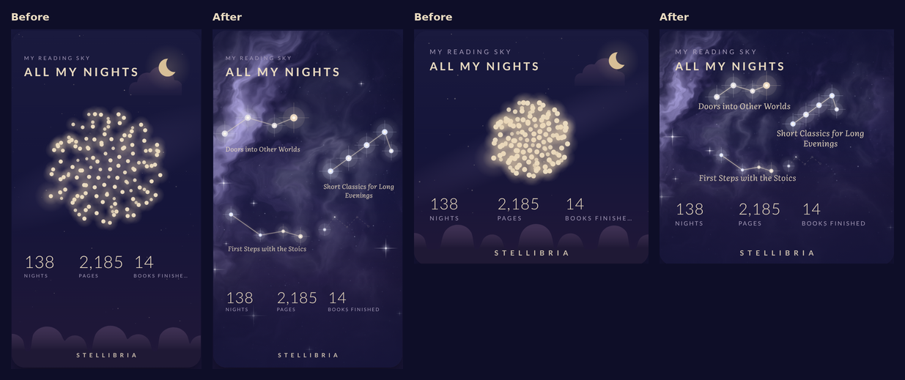

# Phase 27: the share card shows the Sky

**Status:** shipped

The shareable sky card (phase 18) still drew the old sky: one dot per night of
reading on a tight spiral, under the storybook moon and clouds. With months
of reading the dots crowded into one bright ball. The Sky screen has since
become deep space with the reader's books as constellations, so the card now
shows that sky instead.

## What the reader sees

- **Their constellations.** Finished books are stars joined into the
  constellations of their reading paths, named in italic serif underneath,
  with lone books between them. Books not yet read in a path are faint
  outlines on dotted guides, as on the Sky.
- **Room between the stars.** The card uses the Sky's own layout and keeps
  its spacing: one card unit is about one point on a phone. A small sky is
  centred; a big one is shown whole while it fits, and past that the card
  crops around the constellation the Sky opens on rather than squeezing the
  stars together. The square crops sooner, since its sky is shorter.
- **Deep space.** The same nebula, far stars and sparkles as the Sky, in the
  same midnight indigo and plum. No moon or clouds, as on the Sky.
- **This month** draws books finished before the month fainter.
- Names never sit on top of each other or a star; a name with no room is
  left out, read paths first.
- Without book titles the story's sky grows into the room the titles would
  have used.

## How it works

- `src/domain/cardSky.ts` lays the chart out as the Sky's 3D scene
  (`layoutScene`), looks at it face on from the depth of the home
  constellation (`see`), then fits or crops it into the card's sky box.
  Tested in `src/__tests__/cardSky.test.ts`.
- `src/features/share/cardBackdrop.ts` bakes the Sky's backdrop (the same
  shader and star fields, exported from `Atmosphere.tsx`) once per shape into
  a still PNG. The card stays plain views, vectors and an image, so it can be
  captured on any phone.
- `SkyCard.tsx` draws stars, rays, halos and threads in SVG, after the Sky's
  `drawStars` and `drawThreads`.
